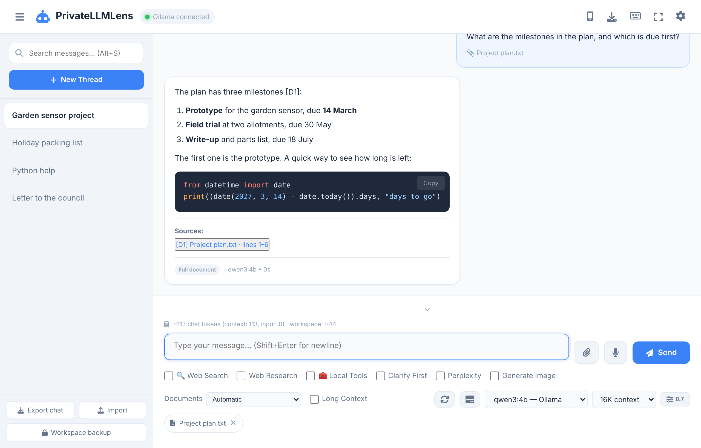
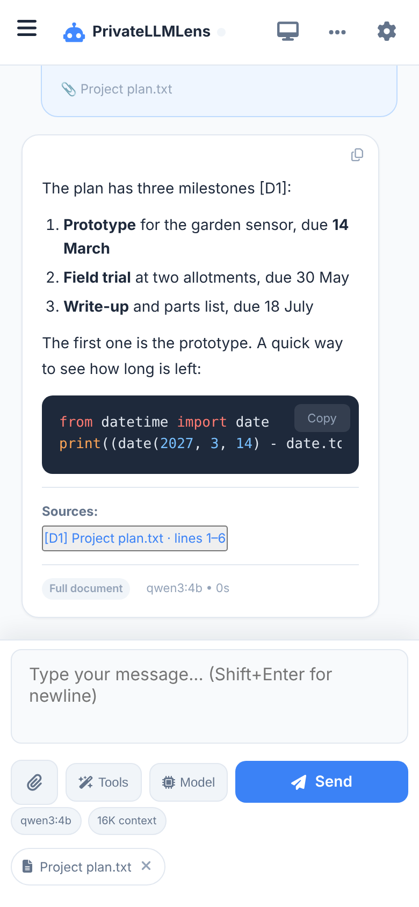

# PrivateLLMLens

Current release: **2.6.0**

PrivateLLMLens is a single file browser interface for local Ollama, llama.cpp and optional in browser WebGPU models. It is deliberately a single page for portability and ease of use, and it works on desktop and on Android with Termux. There is no application server: the page talks straight to your model server.

Try the hosted version: **https://jimliddle.github.io/privatellmlens/**

Or download `index.html` and serve it from `localhost`, `127.0.0.1` or an HTTPS address. Serving it this way lets you install it as an app and keeps your saved data in one place.

<p>
  
  
</p>

## Contents

- [What it does](#what-it-does)
- [Quick start with Ollama](#quick-start-with-ollama)
- [Allowing the page to reach Ollama](#allowing-the-page-to-reach-ollama)
- [One file, and what it loads](#one-file-and-what-it-loads)
- [Working with documents](#working-with-documents)
- [Models and context](#models-and-context)
- [Memories](#memories)
- [Local tools](#local-tools)
- [Web search and cloud services](#web-search-and-cloud-services)
- [While a reply is being written](#while-a-reply-is-being-written)
- [Privacy and stored data](#privacy-and-stored-data)
- [Installing as an app](#installing-as-an-app)
- [Android GPU acceleration](#android-gpu-acceleration)
- [Development](#development)
- [Licence and contributions](#licence-and-contributions)

## What it does

**Chat**

- Streams replies from Ollama, from a llama.cpp server, or from a small model running in the browser.
- Keeps any number of conversation threads, each with its own system prompt and model settings.
- Renders Markdown and highlights code, with a copy button on each reply and each code block.
- Lets you edit a prompt, regenerate a reply, branch a conversation into a new thread, and search across all threads.
- Accepts an image with a prompt when the selected model can read images.
- Lets you cancel a reply or a document being processed at any time.
- Has voice input, light and dark themes, keyboard shortcuts, and a compact layout for phones.

**Documents**

- Reads PDF, DOCX, PPTX, text, CSV, HTML, Python and JSON files in the browser.
- Keeps the documents with the thread, so you can ask further questions without attaching them again.
- Shows where each answer came from, down to the page, slide or line, and opens the source passage when you click it.
- Handles documents too big for the model by finding the relevant passages, or by reading every section in turn.

**Privacy**

- Chats, documents, memories and API keys are encrypted in the browser's storage.
- An optional passphrase lock keeps everything unreadable until you unlock the app.
- Encrypted backups can be saved to a file and restored in another browser.
- Nothing leaves your device unless you switch on a web search or cloud option for a prompt.

**Managing models**

- A model manager for Ollama shows what is loaded, frees memory, deletes models and downloads new ones.
- Context sizes of 8K, 16K and 32K can be picked per chat.

**Optional extras**

- Web search and multi-step web research through Tavily.
- Perplexity answers, OpenAI image generation and Gemini for very long files.
- GPU acceleration on supported Android phones through llama.cpp.

## Quick start with Ollama

1. Install a model and start Ollama:

   ```sh
   ollama pull qwen3:4b
   ollama serve
   ```

2. Open the hosted page, or serve your downloaded `index.html`.
3. Check that the header says **Ollama connected**.
4. Pick a model and start chatting.

If the header says **Disconnected**, see the next section.

The page finds Ollama models at `http://localhost:11434`. You can point it at another address in **Settings → API Configuration**. It also looks for a llama.cpp server at `http://127.0.0.1:8080` and lists its models alongside the Ollama ones.

## Allowing the page to reach Ollama

Ollama only answers web pages it has been told to trust. Out of the box it trusts pages served from your own machine, such as `http://localhost:8765`, and nothing else. To use the hosted page you have to add its address to a setting called `OLLAMA_ORIGINS`.

**Ollama only reads this setting when it starts. After changing it you must quit Ollama and start it again. Refreshing the page is not enough.**

### If you start Ollama from a terminal

```sh
OLLAMA_ORIGINS="*" ollama serve
```

### If you use the Ollama app on a Mac

1. Run this in Terminal:

   ```sh
   launchctl setenv OLLAMA_ORIGINS "*"
   ```

2. Click the Ollama icon in the menu bar and choose **Quit Ollama**.
3. Open Ollama again.
4. Reload PrivateLLMLens.

The Mac forgets this setting when it restarts, so run the command again after a reboot, then quit and reopen Ollama.

The **Expose Ollama to the network** option in the Ollama app's settings is a different thing. It lets other devices reach Ollama. It does not change which web pages Ollama trusts, so it will not fix a page that cannot connect.

### Which value to use

`"*"` trusts every website open in your browser. If you would rather limit it, give only the address you use, for example `"https://jimliddle.github.io"`. Separate several addresses with commas.

### Checking it worked

```sh
curl -i -H "Origin: https://jimliddle.github.io" http://localhost:11434/api/tags
```

If the output includes a line starting `Access-Control-Allow-Origin`, Ollama is set up correctly. If that line is missing, Ollama has not picked the setting up: quit it and start it again.

### If Ollama is set up but the page still says Disconnected

Recent versions of Chrome and Edge ask before a website may contact services on your own computer or network. If you see that prompt, choose **Allow**. If you dismissed it, click the icon at the left of the address bar, open **Site settings**, set **Local network access** to **Allow**, and reload.

## One file, and what it loads

Everything the app needs for its main features is inside `index.html`: the interface, the code, the icons and these libraries.

| Library | Version | Used for |
| --- | --- | --- |
| Marked | 18.1.1 | Markdown |
| DOMPurify | 3.4.17 | Making model output safe to display |
| Highlight.js | 11.9.0 | Code highlighting |
| JSZip | 3.10.1 | Reading DOCX and PPTX files |
| Font Awesome Free | 6.5.1 | The 42 icons the interface uses |

Chat, Markdown, code highlighting, DOCX and PPTX reading, encryption and backups all work with no connection other than the one to your model server. The file is about 790 KB, or about 210 KB when compressed in transit.

Three things are still downloaded, and only when you use them:

- **PDF.js 6.4.299**, the first time you attach a PDF. The page checks the downloaded code against a fingerprint stored in `index.html` and refuses to run it if it does not match. Scripts inside PDF files are never run.
- **Transformers.js 4.2.0 and its model files**, for the optional in-browser chat models and for meaning-based document search (about 25 MB for the search model). These are fixed to a version but are not fingerprint-checked.
- **Fonts** from Google Fonts. Without a connection the page uses your system fonts.

The page also carries a Content Security Policy, which is a set of rules the browser enforces:

- Code may only run from the file itself and from `cdn.jsdelivr.net`.
- Images from other websites are not loaded. If a reply, a web result or a document contains one, you see a link you can choose to open. This matters because an image address can be used to send information to another site.
- Links open in a new tab.
- Frames, plugins and form submissions to other sites are blocked.

Network requests are not restricted, because you can set the Ollama address to anything you like.

There is one optional second file, `sw.js`. It is only needed for notifications on Android and is explained under [While a reply is being written](#while-a-reply-is-being-written). `index.html` works without it.

## Working with documents

Attach a file with the paper clip. The app reads it once, encrypts the text, and stores it with the current thread. Attaching the same file twice does not store it twice. If you branch a conversation, the new thread gets its own copy of the documents.

Supported formats:

- **PDF**, with page numbers
- **DOCX**, including headings, lists, tables, headers, footers, footnotes and endnotes
- **PPTX**, including slide text, tables, speaker notes and image descriptions where the file has them
- **Text, CSV, HTML, Python and JSON**, with line numbers

Older `.doc` and `.ppt` files are not supported. Save them as DOCX, PPTX or PDF first. Scanned documents that contain only pictures of text are not read, and pictures, diagrams and charts inside slides are not interpreted.

### How large documents are handled

The **Documents** setting beside the prompt box has three choices.

- **Automatic** sends the whole document when it fits in the model's context. When it does not fit, the app picks one of the two methods below, based on your question.
- **Exact / targeted** finds the passages most relevant to your question and sends only those.
- **Whole-document analysis** reads every section against your question, then combines the findings. The reply shows how many sections were covered.

### How passages are found

Two searches run in the browser and their results are combined.

- A **keyword search** (BM25) is good at exact words, names, part numbers and code.
- A **meaning search** uses a small model, `all-MiniLM-L6-v2`, so a passage can match even when it uses different words from your question.

The meaning search model is downloaded the first time it is needed, and the app shows how much has been downloaded. Its index is built per document, stored encrypted with the document, and reused afterwards. If the model cannot run on your device, or does not respond for a minute or two, the app carries on with the keyword search alone and marks the reply **keyword search only**.

No document text and no question is sent to any outside service for this.

### Long files in the cloud

**Long Context** is a separate option that sends whole files to Google's Gemini. It needs a Gemini API key and is only used when you tick it for a prompt.

### Safety

Text from documents is passed to the model marked as data to be read. The model is told not to follow instructions found inside it.

## Models and context

### Context size

- **8K** uses the least memory and is the quickest.
- **16K** is the default.
- **32K** suits long conversations and large documents, and uses the most memory.

These apply to Ollama. A llama.cpp server uses the context size it was started with.

Behind the scenes the app sometimes asks the model short questions of its own, for example to decide whether to search the web or to summarise an older part of the chat. These use the same context size as the chat. Ollama reloads a model whenever the context size changes, so keeping one size avoids a delay before and after each of these.

### Long conversations

**Conversation History** in Settings sets how many recent messages are sent to the model word for word. With **Auto-summarise Context** switched on, older messages are replaced by a running summary kept with the thread. The summary is brought up to date every eight messages or so, so most prompts need no extra work.

### Ollama model manager

The drive button beside the model list opens the model manager. It works with your Ollama server and lets you:

- see which models are in memory, how much memory they use, and when Ollama will unload them
- unload a model to free memory straight away
- see every installed model with its size
- delete a model
- download a model by name, with a progress bar and a cancel button

If you cancel a download, Ollama keeps what it has and carries on from there next time.

### Models in the browser

**Settings → WebGPU Models** adds two small Qwen3.5 models that run entirely in the browser, with no Ollama needed. They work in Chrome and Edge. The fast one is about 850 MB to download and the better one about 1.8 GB. The browser keeps them after the first download.

## Memories

The app can remember facts about you and use them in later chats.

- **Use Memories** is on by default. Before each prompt the app picks the saved facts that look relevant, up to ten of them, and gives them to the model.
- **Learn Memories** is experimental and off by default. When switched on, the app looks for lasting facts in your conversations while it is idle and saves them.

You can add, edit and delete memories yourself in **Settings → View Memories**. Up to 200 are kept. Duplicates are ignored, a newer fact replaces an older one it contradicts, and anything that looks like an instruction or a password is not saved. Memories are encrypted.

## Local tools

Tick **Local Tools** for a prompt and the model can use a small set of tools that run in your browser. Nothing is sent off your device.

- a calculator
- the current date and time
- a list of the documents in the thread
- search within those documents
- read an exact part of a document
- look up a value inside JSON

Ollama and llama.cpp models that support tool calling use it directly. Other models, including the in-browser ones, are given a simpler text format that does the same job.

## Web search and cloud services

All of these are optional. Each needs its own API key, entered in Settings, and none is used unless you switch it on.

| Option | What it does | What leaves your device |
| --- | --- | --- |
| **Web Search** | One Tavily search, then your local model answers | The search query |
| **Auto-search** | The app decides whether a prompt needs a search. If unsure, it does not search | The search query, when it searches |
| **Web Research** | Up to three Tavily searches, then your local model writes the answer with sources | The search queries |
| **Perplexity** | Perplexity answers the prompt | The prompt |
| **Generate Image** | OpenAI creates an image | The prompt |
| **Long Context** | Gemini reads whole files | The prompt and the files |

API keys are stored encrypted in the browser. They are never included in exports or backups.

## While a reply is being written

Every step of a request shows a status line in the chat: what the app is doing, any progress it can count, and the seconds since you pressed Send. If the clock is running, the app is working. A **Cancel** button sits just above the prompt box for the whole time.

Some models think before they answer. While they do, the line reads **Reasoning** and the reply appears once the model starts writing it.

### Waiting for the first word

A model server sends nothing back while it loads a model and reads your prompt. For a long prompt on a slow machine that silence can last many minutes. The status line fills the gap with what the app knows:

- **Loading the model** or **Reading your prompt**. With Ollama the app asks the server whether the model is in memory yet.
- **The size of the prompt**, for example "about 5,000 tokens". This includes history and any document text.
- **How long that usually takes**, once the app has seen this model answer at least once on this machine.
- **Where the model is running.**

### Where the model is running

Beside the model list, and as a chip under the prompt box on a phone, the app shows where the selected model runs:

- **Ollama · GPU**, **Ollama · processor** or **Ollama · 60% GPU**. This comes from Ollama itself and appears once the model has been loaded. Processor only is shown in amber because it is much slower.
- **GPU server** or **llama.cpp server** for models served by llama.cpp.
- **in this browser** for the WebGPU models.

### Token figures

Under each reply the app shows what the model server reported: how many tokens it read and wrote, and the speed of each, for example "read 5,012 tokens at 4.9/s · wrote 312 at 3.1/s". The app remembers these speeds for each model and uses them for the estimate above. Nothing is guessed from the type of device, so the same page gives the right picture on a phone and on a desktop.

Two settings help with long answers, mainly on phones. Both are in **Settings → While generating**.

- **Keep screen awake** is on by default. It stops the screen from locking during a reply or a model download, because a locked phone pauses the page and the reply stalls.
- **Alert when a reply finishes in the background** is off by default. When it is on and the app is not in front, it shows a notification, changes the tab title and plays a short sound when the reply is ready.

The alert never shows your prompt, the reply or the thread name. Notifications can appear on a lock screen, so it only says that a reply is ready.

Android browsers will not show a notification from a web page by itself. They need a small helper file called a service worker. That is what `sw.js` is for. It stores nothing and does not touch your requests. The app only uses it once you switch the alert on. If the file is missing, the alert still changes the title and plays the sound.

## Privacy and stored data

Everything is stored in your browser, for the address you opened the app from. A different address, port or browser has its own separate storage.

### What is encrypted

Chats, thread names, system prompts, documents, memories and API keys are all encrypted with AES-256-GCM. The only parts left readable are the ones the database needs to keep things in order: record numbers, which thread a message belongs to, timestamps, and whether a message came from you or the model.

Chats saved by versions before 2.5 are encrypted the first time 2.5 opens them. After that an older copy of `index.html` cannot read them. If you keep your own copy of the file, replace it with the current one.

### Passphrase lock

Without a passphrase, the encryption key is kept in the browser next to the data. That stops someone casually looking through browser storage, but it would not stop someone who has a copy of your whole browser profile.

**Settings → Security → Set passphrase** closes that gap. The app creates a new key, encrypts everything again with it, and stores the key only in a form that your passphrase unlocks. From then on:

- the app asks for the passphrase every time it opens
- nothing can be read until you enter it
- **Lock now** locks it straight away
- it can lock itself after 1, 5, 15 or 60 minutes in the background

**If you forget the passphrase, your data cannot be recovered.** The only option left is to erase everything. Save an encrypted backup before you set a lock. The backup has its own password and does not depend on the lock.

The lock protects stored data. It does not protect the app while it is open and unlocked.

For those who want the detail: the key is wrapped with AES-256-GCM using a key derived from the passphrase by PBKDF2-SHA256 with 600,000 rounds.

### Keeping your data

Browsers are allowed to clear a website's storage when a device runs short of space. That would remove your chats, documents and keys together.

The app asks the browser to protect its storage once you have saved something, and straight away when it is installed as an app. Chrome and Edge usually agree without asking you, especially for an installed app. Firefox shows a prompt.

**Settings → Storage** shows:

- whether storage is protected
- how much space is used
- how many threads, messages, documents and memories are stored
- when you last saved an encrypted backup

A notice appears in the sidebar if your data is unprotected and has never been backed up, or if storage is nearly full. If something cannot be saved, for example because storage is full, the app tells you.

Protection only stops the browser clearing storage by itself. Clearing site data, removing the browser or changing device still removes everything. A backup file is the only copy that survives those.

### Backups and exports

- **Export chat** saves your conversations as a plain, readable JSON file. It leaves out API keys, memories and documents.
- **Workspace backup** saves conversations, documents and memories in one file, encrypted with a password you choose. It leaves out API keys and server addresses.
- **Import** restores either kind of file. Your existing data is kept and the imported data is added to it.

Keep the backup password safe. The app cannot recover it. Backups use PBKDF2-SHA256 with 310,000 rounds and AES-256-GCM.

### Voice input

Voice input uses your browser's speech recognition. In Chrome this normally sends the audio to Google to be turned into text. Do not use it for anything you want to keep on your device.

### Limits

The encryption protects data at rest in the browser. It does not protect against harmful code running inside the page, so the code the page loads matters. That is why the main libraries are built in, PDF.js is checked before it runs, and model output is cleaned before it is shown.

## Installing as an app

Open the app from an HTTPS address, `http://localhost` or `http://127.0.0.1`, then use the install button in the header or your browser's **Add to Home screen**. Browsers do not allow installing from a file opened directly from disk.

On a phone the prompt box is compact, with **Tools** and **Model** buttons that open panels from the bottom of the screen. The button in the header switches between the compact and desktop layouts. **Settings → Appearance → Layout** also offers **Automatic**, which picks a layout to suit the screen.

Zooming works as normal, form fields are labelled for screen readers, and dialogs keep keyboard focus inside them.

## Android GPU acceleration

On some Android phones, llama.cpp can use the phone's graphics chip, which is much faster than the processor alone. Build instructions, scripts, model profiles and troubleshooting are in [`android-termux/`](android-termux/README.md).

Results on a Samsung Galaxy Z Fold 8:

| Profile | Model | Context | Reading the prompt | Writing the reply |
| --- | --- | ---: | ---: | ---: |
| `qwen3-4b` | Qwen3 4B Q4_K_M | 32K | 287 tokens/s | 19.8 tokens/s |
| `mistral-7b` | Mistral 7B Q4_K_M | 16K | 147 tokens/s | 13.2 tokens/s |
| `deepseek-r1-8b` | DeepSeek-R1/Qwen3 8B Q4_K_M | 8K | 141 tokens/s | 11.5 tokens/s |
| `gemma4-e4b` | Gemma 4 E4B Q4_0 | 8K | 203 tokens/s | 17.7 tokens/s |

The launcher script runs either Ollama or the GPU server, never both, because a phone does not have the memory for two large models at once.

```sh
privatellmlens                    # start with the last one you used
privatellmlens --gpu qwen3-4b    # switch to the GPU server and remember it
privatellmlens --ollama          # switch to Ollama and remember it
privatellmlens --gpu-list        # list the GPU profiles
privatellmlens --stop
```

Ollama is the default until you switch.

## Development

There is nothing to build. Edit `index.html`, reload the page and test against a local model server.

The built-in libraries and icons sit in a marked block near the top of the file. That block is written by a script from the versions listed in `package.json`:

```sh
npm run vendor
```

Run it after changing a library version, or after using a Font Awesome icon the page has not used before. The tests fail if the block is out of date.

Tests need Node.js 22 or newer:

```sh
npm ci
npm test                          # tests that run in Node
npx playwright install chromium
npm run test:browser              # tests that run in a real browser
```

`npm run test:all` runs both. The tests use made-up model replies, so they need no model server and no paid API keys. GitHub Actions runs them on every pull request and on `main`.

If a test browser cannot be started on your machine, run `node tests/server.cjs` and open `http://127.0.0.1:18767/native` in your own browser. It runs a set of checks in the page against a separate test database.

To check the main script for syntax errors:

```sh
awk '/^  <script>$/{inside=1;next} /^  <\/script>$/{inside=0} inside{print}' index.html > /tmp/privatellmlens.js
node --check /tmp/privatellmlens.js
```

A fuller list of features is in [`corefunctionality.md`](corefunctionality.md).

## Licence and contributions

PrivateLLMLens is released under the BSD 3-Clause licence. See [`LICENSE`](LICENSE). The licences of the built-in libraries are in the `third party licenses` folder.

Issues, pull requests and suggestions are welcome. If a change touches security, please keep in mind that the app is one file and that the page can read the user's chats, documents and unlocked API keys.
